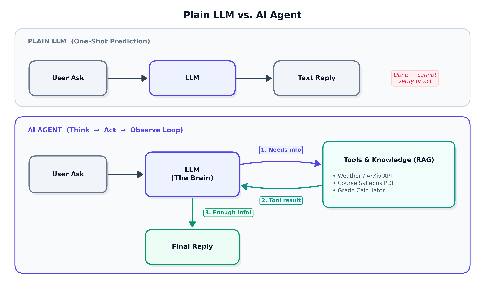
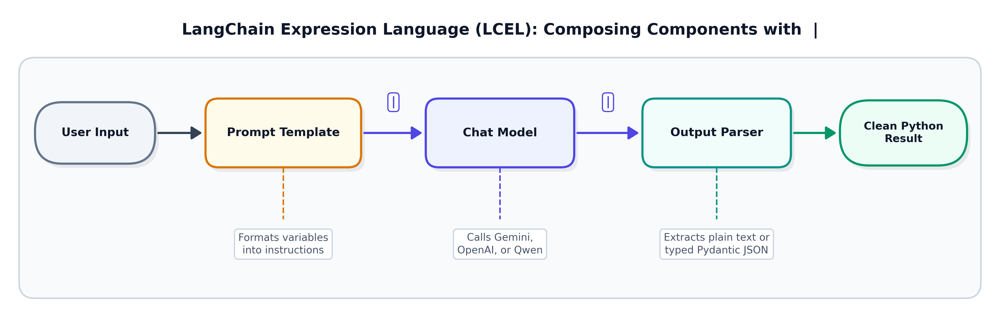
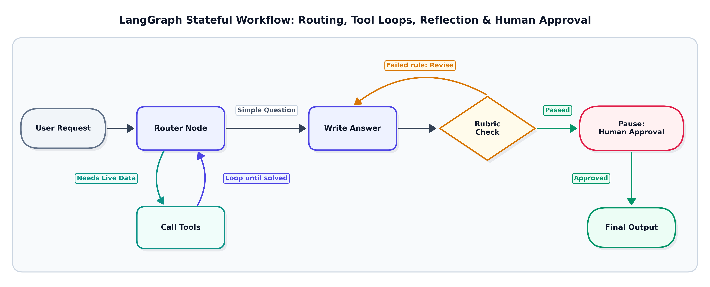

# Agents, LangChain & LangGraph (With Figures)

*New to AI engineering? Read this 2-minute visual guide first.*

---

## 1. Plain LLM vs. AI Agent

A standard **Large Language Model (LLM)** like Gemini or GPT can only take text in and predict text out. It cannot check today's weather, search your private files, or run a calculator on its own.

An **AI Agent** wraps that LLM in a **loop** and gives it **tools** and **memory / RAG** so it can take actions, read the results, and decide what to do next.

### Figure 1: Chatbot vs. AI Agent

  
   
  <em>Figure 1: A plain LLM predicts once, while an AI Agent loops over external tools and RAG knowledge.</em>

---

## 2. What is LangChain? (The Building Blocks)

**LangChain** is a Python toolkit that gives you **standardized building blocks** so you don't have to write raw API code and so you can swap models (here: Gemini, OpenAI, or local Hugging Face) by changing **one line**.

Its signature feature is the **pipe operator (`|`)**, which snaps components together like bricks into a straight-line pipeline:

### Figure 2: A LangChain Pipeline (`|`)

  
   
  <em>Figure 2: Composing prompts, chat models, and output parsers in LangChain using the pipe (<code>|</code>) operator.</em>

**When LangChain alone is enough:** Straight-line tasks (`Summarize this article`, `Extract fields from an email`, `Answer a question from a PDF`).

---

## 3. What is LangGraph? (The Traffic Controller)

Straight-line pipelines break down when an AI needs to **make decisions**, **retry mistakes**, **remember past turns**, or **pause for human approval**.

**LangGraph** lets you wire your AI workflow as a **flowchart (a graph)** with three simple pieces:
1. **State:** A shared clipboard (Python dictionary) passed from step to step.
2. **Nodes:** Python functions that read the clipboard and write updates back to it.
3. **Edges:** Arrows connecting nodes including **conditional branches** (`if/else`) and **loops** (cycles).

### Figure 3: Why Graphs Beat Chains

  
   
  <em>Figure 3: Stateful routing, tool loops, cyclic reflection, and Human-in-the-Loop checkpoints in LangGraph.</em>

---

## 4. Summary: How All Three Fit Together

| Concept | What It Actually Does |
| :--- | :--- |
| **LLM** | Understands language, reasons, and generates text or tool requests. |
| **LangChain** | Connects prompts, models, parsers, vector databases (RAG), and `@tool` functions. |
| **LangGraph** | Controls **loops, branching, multi-agent handoffs, memory, and human pause/resume**. |